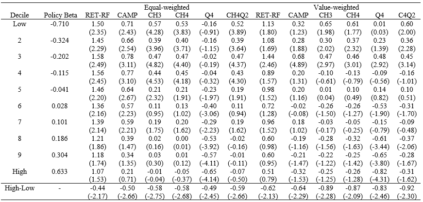

## Abstract

We examine monetary policy reports and the cross-section of Chinese stock returns. Using a large language model, we construct a policy index from the People’s Bank of China’s Monetary Policy Reports and estimate stock beta. The lowest policy beta decile outperforms the highest by 5.28%–7.44% annually across weighting schemes. This premium survives risk adjustment and characteristic controls, persists for nine months, and strengthens after 2016. Higher policy betas predict smaller cash buffers, higher debt-to-market-equity ratios, greater equity issuance, and lower market betas. These findings identify monetary policy policy exposure as a distinct predictor of stock returns and firms’ subsequent financial characteristics.

## Important table & figure

::: {layout-ncol="2"}

:::

<!-- ## Attachment

The monthly policy index constructed in this paper is available for download:

<a href="att/policy_index.xlsx" class="btn btn-outline-dark btn-sm" download="policy_index.xlsx"><i class="bi bi-file-earmark-excel"></i> policy_index.xlsx</a> -->

<!--  -->